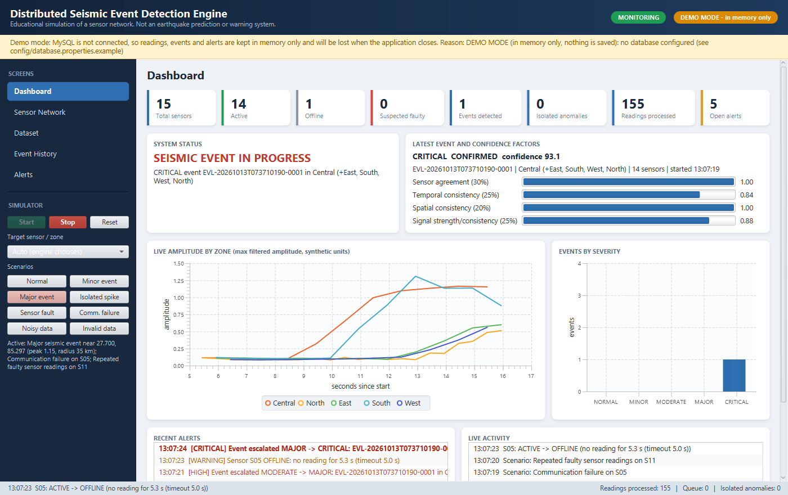

# Distributed Seismic Event Detection Engine

A Java 17 / JavaFX desktop application that simulates a network of 15 virtual seismic sensors. It processes
their readings concurrently and uses **multi-sensor correlation** to decide whether abnormal readings are a
seismic event, an isolated anomaly, a faulty sensor, noise, invalid data, or a communication failure.
Events and alerts are stored in MySQL through JDBC.

> **Educational simulation.** This is not an earthquake prediction system or a certified early-warning
> service. All sensor data is synthetic. Amplitude thresholds and confidence scores are project-defined
> values, not real magnitudes or calibrated probabilities.



## Features

| # | Feature | Where |
|---|---|---|
| 1 | Virtual network of 15 sensors in 5 zones (ID, name, zone, lat/lon, status, reliability, heartbeat, latest reading), drawn on a JavaFX canvas | `data/sensors.csv`, Sensor Network screen |
| 2 | Concurrent real-time simulation (one periodic task per sensor on a `ScheduledExecutorService`) with 8 scenarios and a reproducible seed | `simulation/SensorSimulator` |
| 3 | CSV dataset (1,493 rows) with data dictionary; import, validation (valid / suspicious / invalid / rejected), moving-average noise filter, statistics, search, export; separate import of a real USGS catalog | `dataset/`, Dataset screen |
| 4 | Detection engine: threshold candidates → temporal + spatial + signal correlation → fault detection → communication monitoring | `processing/` |
| 5 | Explainable confidence score (0–100) and rule-based severity (NORMAL…CRITICAL); event lifecycle CANDIDATE → CONFIRMED/UNCERTAIN → RESOLVED, or DISMISSED | `ConfidenceCalculator`, `SeverityClassifier` |
| 6 | Alerts with duplicate control, acknowledgement and a priority queue | `alert/AlertManager`, Alerts screen |
| 7 | JavaFX dashboard: live charts, metrics, network map, event history with decision explanations | `controller/`, `ui/`, `resources/fxml` |
| 8 | MySQL 8 schema (7 tables, FKs, indexes, CHECK constraints) and JDBC repositories with transactions; demo mode without MySQL | `resources/db/schema.sql`, `repository/` |

## Technology stack

| Component | Version | Notes |
|---|---|---|
| Java | 17 LTS (the installed JDK); compiles and runs on 21 | `maven.compiler.release=17` |
| Maven | 3.9.14 via the included wrapper (`mvnw`, `mvnw.cmd`) | no global Maven needed |
| JavaFX | 21.0.5 (controls, fxml) | needs JDK 17+ |
| MySQL | 8.0 or 8.4 | |
| JDBC driver | MySQL Connector/J 8.4.0 | |
| Logging | SLF4J 2.0.16 + Logback 1.5.12 | logs to console and `logs/` |
| Tests | JUnit 5.10.3, H2 2.2.224 (test scope, MySQL mode) | |

## Prerequisites

* JDK 17 or newer on the `PATH` (`java -version`).
* Internet access the first time you build, so Maven can download dependencies.
* Optional: MySQL Server 8.x for persistence. Without it the app runs in **demo mode** (see below).

## Build, test and run

Always run commands **from the project folder**. The app reads `data/` and `config/` relative to it.

```bat
:: Windows
mvnw.cmd clean test          :: compile and run the unit/integration tests
mvnw.cmd clean package       :: tests + target\SeismicEngine.jar (runnable jar with all dependencies)
mvnw.cmd javafx:run          :: start the application
java -jar target\SeismicEngine.jar   :: or start the packaged jar (or double-click run.bat)
```

```sh
# macOS / Linux
./mvnw clean test
./mvnw clean package
./mvnw javafx:run
```

`target/SeismicEngine.jar` contains the JavaFX native libraries of the OS it was built on (Windows here).
On another OS, build it there or use `javafx:run`. Starting it prints the harmless warning
`Unsupported JavaFX configuration: classes were loaded from 'unnamed module'`.

## MySQL setup

1. Install MySQL Server 8.x and start it.
2. Create the database and tables (the script is idempotent):
   ```bat
   mysql -u root -p < src\main\resources\db\schema.sql
   ```
3. (Recommended) create an application user instead of using root:
   ```sql
   CREATE USER 'seismic_app'@'localhost' IDENTIFIED BY 'choose-a-password';
   GRANT SELECT, INSERT, UPDATE, DELETE, CREATE, INDEX, REFERENCES ON seismic_engine.* TO 'seismic_app'@'localhost';
   ```
4. Configure the connection. Copy `config\database.properties.example` to `config\database.properties`
   (git-ignored) and set `db.user` / `db.password`. Alternatively, set environment variables, which take
   priority:
   ```bat
   set SEISMIC_DB_URL=jdbc:mysql://localhost:3306/seismic_engine?connectTimeout=3000&rewriteBatchedStatements=true
   set SEISMIC_DB_USER=seismic_app
   set SEISMIC_DB_PASSWORD=choose-a-password
   ```
5. Start the app. The header shows a green **MySQL connected** pill. At start-up the app verifies the
   connection, creates any missing tables and saves the 15 sensors.
6. Verify in MySQL after a run:
   ```sql
   USE seismic_engine;
   SELECT event_id, status, severity, confidence, affected_zone FROM detected_events ORDER BY start_time_utc DESC;
   SELECT e.event_id, a.sensor_id, a.distance_from_origin_km FROM detected_events e
     JOIN event_sensor_associations a ON a.event_id = e.event_id ORDER BY e.event_id;
   SELECT alert_type, severity, description, acknowledged FROM alerts ORDER BY created_at_utc DESC;
   SELECT COUNT(*) FROM readings;
   ```
7. Optional: run the repository tests against MySQL. These tests **delete rows**, so use a separate database
   whose name contains `test`:
   ```bat
   mysql -u root -p -e "CREATE DATABASE seismic_engine_test"
   set SEISMIC_TEST_DB_URL=jdbc:mysql://localhost:3306/seismic_engine_test
   set SEISMIC_TEST_DB_USER=root
   set SEISMIC_TEST_DB_PASSWORD=...
   mvnw.cmd test -Dtest=MySqlRepositoryIntegrationTest
   ```

### Demo mode (no MySQL)

If `config/database.properties` is missing, or MySQL cannot be reached, the app still works fully. It uses
in-memory repositories and shows an orange **DEMO MODE – in memory only** pill, plus a banner with the
reason. Nothing is saved, and history is lost when the app closes. The app never claims data was persisted
when it was not.

## Configuration

| File | Purpose |
|---|---|
| `config/database.properties` | MySQL URL/user/password (create from the `.example`; never commit it) |
| `config/engine.properties` | Optional overrides of every threshold, window, weight and simulator setting. The file lists all defaults as comments |
| `src/main/resources/logback.xml` | Logging levels and log file location |

All timestamps are handled as `Instant` (UTC) in Java and stored as UTC `DATETIME(3)` in MySQL. The UI
shows times in the computer's local time zone.

## Dataset format

`data/seismic_sensor_readings.csv` (synthetic):

```
reading_id,sensor_id,timestamp_utc,amplitude,frequency_hz,duration_s,noise_level,scenario_label
D00001,S01,2026-10-01T08:00:00Z,0.0822,7.900,0.640,0.090,NORMAL
```

See [`data/data_dictionary.md`](data/data_dictionary.md) for units, ranges and validation rules, and
[`data/README.md`](data/README.md) for how the data was generated and what each scenario should produce.
Imported files need the same columns; the column order is free and a few aliases are accepted.

## Demo scenarios (live simulator)

Press **Start** in the left panel, then use the scenario buttons. "Target sensor / zone" picks the sensor
(for single-sensor scenarios) or the zone (for events); *Auto* lets the engine choose.

| Button | What the simulator does | What you should see (about 5–20 s) |
|---|---|---|
| Normal | clears every active scenario | quiet background, status NORMAL |
| Minor event | 8 s shaking in one zone (3 sensors) | CONFIRMED → RESOLVED, severity MINOR, alert |
| Major event | 12 s strong shaking from the Central zone, reaching outer zones ~5 s later | CONFIRMED, MAJOR/CRITICAL, 12–15 sensors, escalation alerts |
| Isolated spike | one short 30 Hz knock on one sensor | CANDIDATE → DISMISSED after 5 s, INFO "isolated anomaly" alert, small reliability drop |
| Sensor fault | one sensor sends repeated spikes and out-of-range values for 25 s | sensor turns FAULTY (red) with a HIGH alert, then recovers after 20 good readings |
| Comm. failure | one sensor stops sending for 15 s | OFFLINE (grey) after 5 s, WARNING alert, then ACTIVE again with a recovery alert |
| Noisy data | one sensor's noise level > 0.6 for 20 s | readings SUSPICIOUS, excluded from correlation; no event, no fault |
| Invalid data | one sensor sends missing/negative/impossible values for 12 s | readings INVALID, sensor FAULTY after 3 of 10 invalid |

**Dataset screen:** *Load bundled dataset* → *Analyse dataset*. The replay finds a MINOR event (North),
a CRITICAL event (Central), an UNCERTAIN two-sensor event (East), a dismissed spike (S08), S11 and S13
FAULTY, and S05 OFFLINE then recovered. A five-minute walkthrough is in
[`docs/demo_script.md`](docs/demo_script.md).

## Project structure

```
pom.xml, mvnw, mvnw.cmd, run.bat
config/      database.properties.example, engine.properties
data/        seismic_sensor_readings.csv, sensors.csv, data_dictionary.md, README.md, samples, usgs_sample_catalog.csv
docs/        architecture.md, algorithms.md, database_design.md, testing.md, demo_script.md, java_concepts.md, screenshots/
scripts/     generate_demo_dataset.cmd / .sh
src/main/java/com/seismic/
  Main, Launcher, AppContext          entry points and composition root
  model/       domain classes and enums (Sensor, SeismicReading, SeismicEvent, Alert, ...)
  config/      ProcessingConfig, SimulationConfig, ConfigLoader
  dataset/     CsvDatasetLoader, DataValidator, NoiseFilter, DatasetStatisticsService, CsvExporter, UsgsCatalogLoader, DemoDatasetGenerator
  simulation/  SensorSimulator, ReadingGenerator, ScenarioPlanner, scenario effects
  processing/  EventDetector, EventCorrelator, ConfidenceCalculator, SeverityClassifier, SensorFaultDetector,
               CommunicationMonitor, EventProcessingPipeline, DatasetAnalyzer
  alert/       AlertManager
  service/     SeismicEventService, DatasetService, EngineListener, IdGenerator
  database/    DatabaseConfig, DatabaseConnection, SchemaInitializer
  repository/  interfaces + jdbc/ (MySQL) + memory/ (demo mode)
  controller/  JavaFX controllers (one per screen)
  ui/          LiveDataBridge, SensorNetworkCanvas, ControllerFactory, FxTasks, UiFormat, UiSmokeTest
src/main/resources/  fxml/, css/app.css, db/schema.sql, logback.xml
src/test/java/com/seismic/  JUnit 5 tests (see docs/testing.md)
```

## Documentation

* [Architecture and data flow](docs/architecture.md)
* [Algorithms and formulas](docs/algorithms.md)
* [Database design](docs/database_design.md)
* [Testing and results](docs/testing.md)
* [Five-minute demo script](docs/demo_script.md)
* [Java concepts map for the review](docs/java_concepts.md)

## Known limitations

* **Synthetic data only.** The signal model is a simplified illustration (exponential attenuation, a constant
  6 km/s propagation speed, no P/S waves, no site effects). Thresholds and weights are hand-chosen.
* **The confidence score is not a probability.** It is an explainable weighted index.
* **The origin is the first-triggering sensor**, not a computed epicentre, so the spatial checks are approximate.
* **MySQL was not available on the development machine.** The JDBC code was tested against H2 in MySQL
  compatibility mode, but the MySQL integration tests (`MySqlRepositoryIntegrationTest`) have **not** been run
  against a real MySQL server. See `docs/testing.md`.
* One JDBC connection is opened per operation (no connection pool). This is fine for this workload, but a pool
  would be needed at a larger scale.
* The runnable jar is OS-specific because it bundles that OS's JavaFX natives.
* Event history kept in memory is limited to the newest 300 events, and alerts to 2,000. Older entries remain in MySQL.
* Dismissed single-sensor candidates are not stored as events (they appear as ISOLATED_ANOMALY alerts), so
  event IDs in the database can have gaps.

## Troubleshooting

| Problem | Fix |
|---|---|
| `data/sensors.csv` not found / app shows "could not start" | Run from the project folder (`cd DistributedSeismicEventEngine`) or use `run.bat` |
| Header shows DEMO MODE with "Access denied" | Wrong `db.user`/`db.password` in `config/database.properties` |
| DEMO MODE with "Database does not exist" | Run `schema.sql` (MySQL setup step 2) |
| DEMO MODE with "Cannot reach MySQL" | Start the MySQL service; check host/port in `db.url` |
| `mvnw` cannot download dependencies | Check internet/proxy access to `repo.maven.apache.org`; after one successful build `mvnw -o ...` works offline |
| `Error: JavaFX runtime components are missing` | Start with `mvnw javafx:run` or `java -jar target/SeismicEngine.jar` (it uses `Launcher`), not `java com.seismic.Main` on a plain classpath |
| Scenario buttons are greyed out | Press **Start** first; scenarios act on live monitoring |
| Window opens but charts are empty | Monitoring is stopped; press **Start** |
