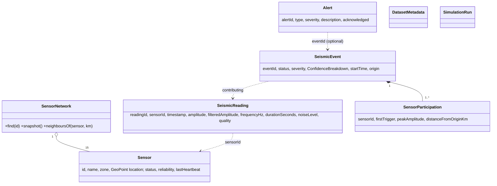

# Architecture

## Layers

| Layer | Package | Responsibility | Depends on |
|---|---|---|---|
| Presentation | `controller`, `ui`, `resources/fxml`, `resources/css` | JavaFX screens, user input, thread hand-over to the JavaFX thread | service |
| Service | `service`, `alert` | Use cases: live monitoring, dataset analysis, alert handling; owns threads | processing, simulation, dataset, repository |
| Processing | `processing` | Detection algorithms, single-threaded and free of I/O | model, dataset (validator, filter), config |
| Simulation | `simulation` | Virtual sensors and scenario effects | model, config |
| Dataset | `dataset` | CSV loading, validation, filtering, statistics, export | model |
| Persistence | `repository`, `repository.jdbc`, `repository.memory`, `database` | JDBC/MySQL or in-memory storage behind interfaces | model |
| Domain | `model`, `config` | Entities, value objects, enums, settings | – |

Rules that keep this separation:

* Controllers contain no SQL and no detection logic; they call services.
* The processing classes do no I/O and know nothing about JavaFX or JDBC, which is why they can be unit-tested
  with plain objects.
* Services depend on repository **interfaces**, so MySQL and demo mode are the same code with a different
  `Repositories` object.
* `AppContext` is the only place where objects are created and wired (constructor injection).

## Data flow

```
Virtual sensors → Reading generation → Validation → Noise filtering → Candidate detection
→ Multi-sensor correlation → Sensor fault & communication monitoring → Confidence → Severity
→ Alert management → MySQL persistence → JavaFX dashboard
```



```mermaid
flowchart LR
    subgraph SIM["Simulation (sensor-sim-1..4 threads)"]
        S["15 virtual sensors<br/>SensorNetwork"] --> G["ReadingGenerator<br/>+ ScenarioEffects"]
    end
    CSV[("seismic_sensor_readings.csv<br/>user CSV import")] --> L["CsvDatasetLoader"]
    G -- "BlockingQueue&lt;SeismicReading&gt;" --> P
    L --> DA["DatasetAnalyzer<br/>(replay with data time)"] --> P

    subgraph PROC["EventProcessingPipeline (event-processor thread)"]
        P["CommunicationMonitor<br/>heartbeat"] --> V["DataValidator"]
        V --> F["NoiseFilter<br/>moving average"]
        F --> D["EventDetector<br/>thresholds → candidate"]
        D --> FD["SensorFaultDetector<br/>reliability"]
        D --> C["EventCorrelator<br/>time + space + signal"]
        C --> CC["ConfidenceCalculator"]
        CC --> SC["SeverityClassifier"]
        T(["tick every 500 ms:<br/>timeouts → OFFLINE<br/>close events → RESOLVED /<br/>UNCERTAIN / DISMISSED"]) -.-> C
        T -.-> P
        C -. "dismissed single-sensor<br/>candidate" .-> FD
    end

    SC --> AM["AlertManager<br/>dedup + PriorityQueue"]
    FD --> AM
    P --> AM
    SC --> SVC["SeismicEventService"]
    AM --> SVC
    SVC -- "persistence thread (FIFO)" --> R["Repositories<br/>(interfaces)"]
    R --> J[("MySQL 8<br/>JDBC")]
    R --> M[("In-memory<br/>demo mode")]
    SVC -- "EngineListener callbacks" --> B["LiveDataBridge<br/>ConcurrentLinkedQueue"]
    B -- "JavaFX Timeline (500 ms)<br/>on FX thread" --> UI["Dashboard · Sensor Network ·<br/>Dataset · Event History · Alerts"]
    UI -- "button clicks<br/>(FxTasks background)" --> SVC
```

### Step by step for one live reading

1. **Generation**: a `sensor-sim-N` thread runs the periodic task of, for example, S04. `ReadingGenerator` creates
   background values from S04's own seeded `Random`, then applies each active `ScenarioEffect`. A
   `SeismicWaveEffect` adds attenuated shaking once the wave has "arrived". A `CommunicationDropEffect` makes the
   reading disappear. The reading is `offer`ed to the bounded `LinkedBlockingQueue`.
2. **Heartbeat**: the `event-processor` thread takes it and `CommunicationMonitor` records the arrival.
3. **Validation**: `DataValidator` marks it VALID / SUSPICIOUS / INVALID (or rejects it).
4. **Noise filtering**: `NoiseFilter` adds the moving average of S04's last 3 usable amplitudes; the raw value is kept.
5. **Candidate detection**: `EventDetector` compares the raw amplitude with 0.30 / 0.50 / 0.75.
6. **Fault bookkeeping**: `SensorFaultDetector` updates S04's reliability (invalid readings, valid streaks).
7. **Correlation**: a candidate goes to `EventCorrelator`. It joins an open event if it matches in time, space
   and signal; otherwise it opens a new CANDIDATE event.
8. **Confidence → confirmation → severity**: the pipeline recomputes the confidence. It confirms the event when
   at least 3 sensors take part and confidence ≥ 60, then classifies severity.
9. **Timer tick (every 500 ms)**: offline detection, and closing of quiet events: confirmed → RESOLVED;
   2+ sensors without confirmation → UNCERTAIN; single sensor → DISMISSED, which counts as an isolated
   anomaly for the fault detector.
10. **Alerts**: `AlertManager` turns event/status changes into alerts, suppressing duplicates.
11. **Persistence**: readings (batched each tick), events, associations, alerts and sensor states are written
    by the `persistence` thread through the repository interfaces.
12. **UI**: the service calls `EngineListener` methods. `LiveDataBridge` only queues the data. A JavaFX
    `Timeline` drains the queue on the JavaFX thread every 500 ms and updates observable lists and charts.

### Dataset analysis

`DatasetService.analyze` uses the same `EventProcessingPipeline` on a **fresh copy** of the sensor network,
replaying the readings in time order. Before each new second it runs `tick(dataTime)`, so timeouts and event
closing follow the data's own clock. Results are saved (dataset + readings in one transaction, then events)
and added to the Event History screen.

## Threads

| Thread | Created by | Work | Shared state and protection |
|---|---|---|---|
| JavaFX Application Thread | JavaFX | all UI controls | only thread allowed to touch controls |
| JavaFX-Launcher | JavaFX | `Main.init()`: DB connection, history loading | before the UI exists |
| `sensor-sim-1..4` | `SensorSimulator` (`ScheduledExecutorService`) | one periodic task per sensor | `CopyOnWriteArrayList` of effects, per-sensor `Random`, atomics, `BlockingQueue` |
| `event-processor` | `SeismicEventService` (single-thread executor) | entire processing pipeline | sole owner of pipeline state (no locks needed); publishes **copies** |
| `persistence` | `SeismicEventService` (single-thread executor) | all database writes, FIFO | receives immutable snapshots |
| `ui-worker-1..2` | `FxTasks` | start/stop/reset, file and DB queries from screens | results returned via `javafx.concurrent.Task` callbacks |

All worker threads are daemon threads. They are shut down with `shutdown()` + `awaitTermination()` on
Stop, Reset and window close (`Main.stop()` → `AppContext.close()`).

## Object model



Enums: `SensorStatus`, `EventSeverity`, `EventStatus`, `AlertType`, `AlertSeverity`, `ReadingQuality`,
`ReadingSource`, `SignalLevel`, `FaultKind`, `DatasetSourceType`, `ScenarioType`.

## Error handling strategy

| Situation | Handling |
|---|---|
| Malformed CSV row | rejected with line number and reason; the load continues |
| Missing required CSV columns | `DatasetFormatException` → error dialog naming the columns |
| Bad numeric value | reading kept as INVALID with a note |
| Exception while processing one reading | logged, rate-limited PROCESSING_ERROR alert; the processing thread keeps running |
| SQL failure | `RepositoryException` with a friendly message (no credentials) → PROCESSING_ERROR alert / dialog |
| MySQL unreachable at start-up | demo mode with a banner explaining why |
| Exception in a sampling task | logged and caught inside the task (otherwise the executor would silently cancel that sensor) |
