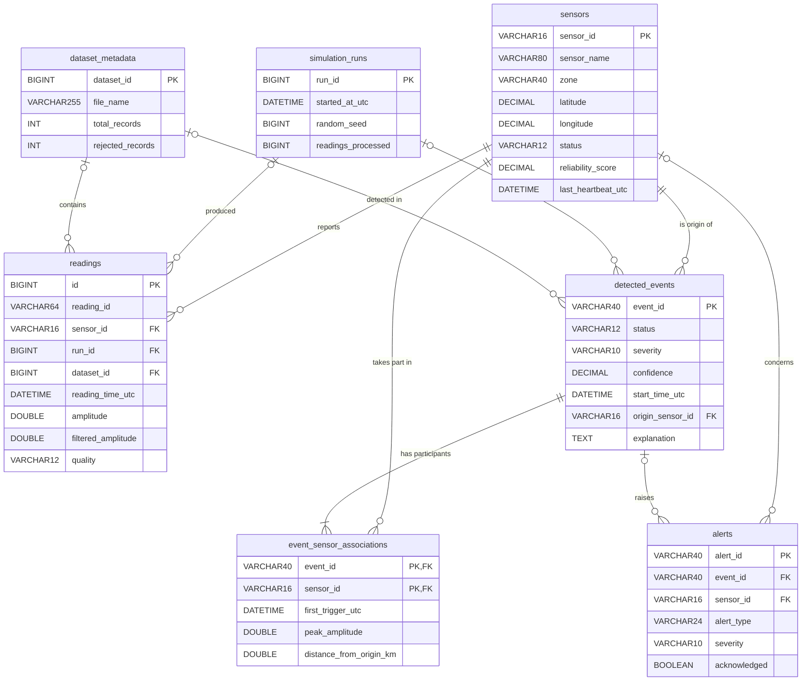

# Database design

Database: **`seismic_engine`** (MySQL 8.x, InnoDB, `utf8mb4`). The script is
[`src/main/resources/db/schema.sql`](../src/main/resources/db/schema.sql). It is idempotent
(`CREATE ... IF NOT EXISTS`), and the application runs its table statements at start-up.

**Time zone.** All `DATETIME(3)` columns store **UTC** with millisecond precision. Java uses `Instant`; the
repositories convert to and from `LocalDateTime` at UTC (`JdbcSupport`), so the server or session time zone
cannot shift values.

**Numbers.** Synthetic measurements are `DOUBLE` (NULL = missing value, NaN in Java). Values shown to users
(reliability, confidence, factor scores, coordinates) are `DECIMAL`, so they round predictably.

## Entity-relationship diagram



## Tables

### `sensors`: the virtual sensor nodes
| Column | Type | Notes |
|---|---|---|
| `sensor_id` | VARCHAR(16) **PK** | `S01`…`S15` |
| `sensor_name`, `zone` | VARCHAR | zone indexed (`idx_sensors_zone`) |
| `latitude`, `longitude` | DECIMAL(9,6) NULL | NULL = unknown coordinates |
| `status` | VARCHAR(12) | CHECK in (ACTIVE, OFFLINE, FAULTY, MAINTENANCE) |
| `reliability_score` | DECIMAL(5,2) | CHECK 0–100 |
| `last_heartbeat_utc`, `updated_at_utc` | DATETIME(3) | |

Written by: start-up (`saveAll`), every status change (`updateState`), Stop/Reset (`saveAll`).

### `simulation_runs`: one row per Start…Stop
`run_id` BIGINT AUTO_INCREMENT **PK**; start/end time, `random_seed`, `sample_interval_ms` (CHECK > 0),
`sensor_count`, `readings_processed`, `events_detected`. It records the settings that produced a run's readings.

### `dataset_metadata`: one row per analysed dataset file
`dataset_id` **PK**; `file_name`, `source_type` (CHECK in BUNDLED, IMPORTED, USGS_CATALOG), `loaded_at_utc`,
counts of total / valid / suspicious / invalid / rejected records, and a CHECK that the counts add up to
the total. Also the first/last reading time and notes.

### `readings`: every processed reading
| Column | Type | Notes |
|---|---|---|
| `id` | BIGINT AUTO_INCREMENT **PK** | surrogate key |
| `reading_id` | VARCHAR(64) | ID from the source (live IDs embed the run: `R12-S04-345`) |
| `sensor_id` | **FK → sensors** | |
| `run_id` | **FK → simulation_runs**, NULL, ON DELETE SET NULL | live readings |
| `dataset_id` | **FK → dataset_metadata**, NULL, ON DELETE CASCADE | dataset readings |
| `reading_time_utc` | DATETIME(3) | |
| `amplitude`, `filtered_amplitude`, `frequency_hz`, `duration_s`, `noise_level` | DOUBLE NULL | raw and filtered values both stored |
| `quality` | VARCHAR(12) | CHECK in (UNCHECKED, VALID, SUSPICIOUS, INVALID) |
| `quality_note`, `source`, `scenario_label` | VARCHAR | `source` CHECK in (SIMULATION, DATASET) |

Indexes: `(sensor_id, reading_time_utc)` for "recent readings of a sensor" and for the contributing-readings
join; `(reading_time_utc)`; `(run_id)`; `(dataset_id)`.

### `detected_events`: correlated events
`event_id` VARCHAR(40) **PK** (e.g. `EVL-20261013T073424123-0001`; `EVL` = live, `EVD` = dataset).
Status (CHECK in the 5 lifecycle values), severity (CHECK), `confidence` DECIMAL(5,2) (CHECK 0–100), the four
factor scores (`temporal_score` / `spatial_score` NULL when unavailable), start / last activity / resolved
time, `origin_sensor_id` **FK → sensors**, origin coordinates, `affected_zone`, `mean_frequency_hz`,
`source`, `run_id` **FK**, `dataset_id` **FK**, and the `explanation` TEXT (the decision log, one line per
decision). Indexes: `(start_time_utc)` for history, `(severity, status)` for statistics.
DISMISSED single-sensor candidates are **not** stored here; they appear as ISOLATED_ANOMALY alerts.

### `event_sensor_associations`: many-to-many events ↔ sensors
Composite **PK `(event_id, sensor_id)`**. `event_id` **FK → detected_events ON DELETE CASCADE**, `sensor_id`
**FK → sensors**. Per participant: `is_origin`, first/last trigger time, peak raw and filtered amplitude,
first frequency, distance from the origin, and the number of candidate readings. Index `(sensor_id)` for
"events per sensor".

### `alerts`
`alert_id` **PK**; `event_id` **FK → detected_events ON DELETE SET NULL** (NULL for sensor/system alerts);
`sensor_id` **FK → sensors**; `alert_type`; `severity` (CHECK in INFO, WARNING, HIGH, CRITICAL);
`description`; `created_at_utc`; `acknowledged` and `acknowledged_at_utc`. Indexes `(created_at_utc)` for
history and `(acknowledged, severity)` for open alerts.

## Why this structure

* **Normalised.** Sensor details live once in `sensors`. An event's participants are rows in the association
  table, not a comma-separated list, so "which events involved S05?" is a simple indexed query.
* **Traceability.** Every reading and event points to the run or dataset that produced it.
* **Integrity.** Foreign keys stop orphans: a reading for an unknown sensor is refused (see the transaction
  test below). CHECK constraints keep enum columns in sync with the Java enums.

## Transactions

| Operation | Repository method | What is atomic |
|---|---|---|
| Save a dataset | `JdbcDatasetRepository.saveDataset` | metadata row **and** all its readings (batched). If any reading fails (e.g. FK violation), the metadata insert is rolled back too |
| Save an event | `JdbcEventRepository.save` / `saveAll` | upsert of the event row + delete and re-insert of its associations, so event and participants never disagree |
| Save sensors | `JdbcSensorRepository.saveAll` | all sensor upserts |
| Save readings | `JdbcReadingRepository.saveBatch` | one batch of live readings |

`JdbcSupport.inTransaction` sets `autoCommit(false)`, commits on success, and calls `rollback()` on any
`SQLException` or `RuntimeException`. The rollback is proven by
`RepositoryContractTest.datasetIsSavedInOneTransactionOrNotAtAll`.

The "upsert" is UPDATE first, then INSERT if no row changed. This is portable, avoids the deprecated
`VALUES()` form of `ON DUPLICATE KEY UPDATE`, and stays clear in a review.

## Queries with joins

```sql
-- Contributing readings of an event: participants' readings inside each sensor's trigger window,
-- from the same run or dataset (JdbcReadingRepository.CONTRIBUTING)
SELECT r.* FROM readings r
JOIN event_sensor_associations a ON a.sensor_id = r.sensor_id
JOIN detected_events e ON e.event_id = a.event_id
WHERE a.event_id = ?
  AND r.reading_time_utc BETWEEN a.first_trigger_utc AND a.last_trigger_utc
  AND ((e.run_id IS NULL AND e.dataset_id IS NULL) OR r.run_id = e.run_id OR r.dataset_id = e.dataset_id)
ORDER BY r.reading_time_utc, r.sensor_id;

-- Participants with their zone (JdbcEventRepository.SELECT_ASSOCIATIONS)
SELECT a.*, s.zone FROM event_sensor_associations a
JOIN sensors s ON s.sensor_id = a.sensor_id WHERE a.event_id IN (?, ?, ...);

-- Events per sensor, including sensors with none (LEFT JOIN + GROUP BY)
SELECT s.sensor_id, COUNT(a.event_id) AS total FROM sensors s
LEFT JOIN event_sensor_associations a ON a.sensor_id = s.sensor_id
GROUP BY s.sensor_id ORDER BY s.sensor_id;

-- Events by severity
SELECT severity, COUNT(*) AS total FROM detected_events GROUP BY severity;
```

All SQL uses `PreparedStatement` parameters; no value is ever concatenated into SQL. The only dynamic part
is the number of `?` placeholders in the `IN (...)` list.

## Useful queries for the review

```sql
USE seismic_engine;
SELECT event_id, status, severity, confidence, affected_zone, start_time_utc FROM detected_events ORDER BY start_time_utc DESC;
SELECT sensor_id, status, reliability_score, last_heartbeat_utc FROM sensors;
SELECT alert_type, severity, description, acknowledged FROM alerts ORDER BY created_at_utc DESC LIMIT 20;
SELECT quality, COUNT(*) FROM readings GROUP BY quality;
SELECT * FROM simulation_runs ORDER BY run_id DESC;
SELECT dataset_id, file_name, total_records, valid_records, invalid_records, rejected_records FROM dataset_metadata;
```
